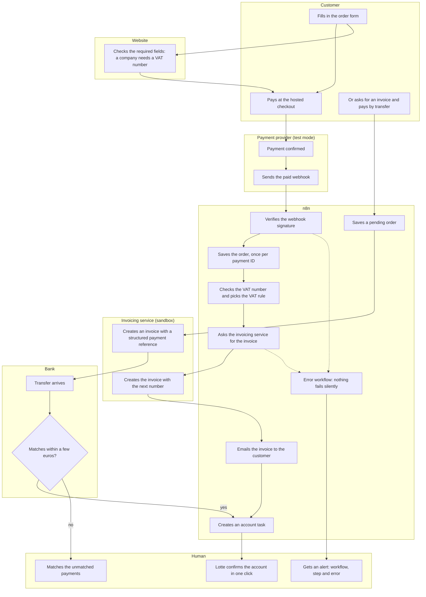

# To-be: how an order becomes money after the automation

Draft, to be redrawn in bpmn.io or draw.io. Anything marked "spike" still has to be confirmed with a test account (see `pre-build-plan.md`). Everything runs in test or sandbox mode, because LoopCasts is a case company.

## What changes, step by step

| Today | After | Estimate |
|---|---|---|
| Lotte retypes each order (5 to 15 min, about 35 a week) | The form and the paid webhook create the order | Complete orders need no typing |
| Marieke makes each invoice by hand (about 8 min, 30 to 35 each Friday) | The invoicing service creates it with the next number | No typing, no duplicate numbers |
| Reverse charge from memory, VAT number not validated | A rule in the invoice step, with a VAT number check | Errors become visible, not silent |
| Friday matching in the KBC app | Card payments confirm themselves; transfers are matched with a small tolerance | Access in minutes instead of up to a week |
| Account typed in phpMyAdmin (about 5 min) | n8n prepares it, Lotte confirms in one click (first version) | Minutes become seconds |
| About 210 monthly invoices copied by hand | Recurring payments and generated invoices (spike) | A day saved each month |

The time figures are the team's own estimates from the handbook, not measurements.

## Requirements

Functional:
1. The order form asks for name, email, product, company, VAT number and country, and refuses to continue when a company has no VAT number.
2. Payment happens at the provider's hosted checkout. Card data never touches our systems.
3. Only a verified paid webhook creates an order, and the same payment ID is processed only once.
4. Each order has a status: paid, invoiced, account pending, account created, failed.
5. The invoice number comes from the invoicing service and is never typed.
6. A foreign EU business with a valid VAT number gets reverse charge. Other VAT rules are confirmed with the accountant first.
7. The invoice is emailed to the customer automatically.
8. First version: a human confirms the account. Later: a "set your password" link replaces the mailed password.
9. Pay-by-invoice: a pending order and an invoice with a structured reference. Transfers are matched with a tolerance of a few euros, and anything unmatched goes to a human list.
10. Monthly subscribers are charged by recurring payment, and a failed charge notifies a human (spike).
11. Support triage classifies a ticket, flags scam mail and drafts a reply. A human approves before anything is sent. The model never sends, resets or refunds on its own.

Quality:
1. No secrets in the workflow: credentials live in n8n's credential store or `.env`.
2. Nothing fails silently: the error workflow sends a human the workflow name, the failing step, the message and a link.
3. Every external call has a timeout and a limited number of retries. The order is saved before invoicing, so a failure never loses it.
4. Data minimisation: only the email text goes to the language model, and order lookups happen in n8n after the model.
5. Invoice data is never deleted by the automation (kept seven years).
6. Someone else can run it from the documentation.

## What stays human on purpose

- Confirming accounts (first version).
- Approving every support reply.
- Refunds and cancellations (the handbook says "ask Marieke first").
- Unmatched payments.
- Anything the error workflow reports.

## How we will judge it

| Measure | Today | Target |
|---|---|---|
| Typing time per complete order | 5 to 15 min | none |
| Time to make an invoice | about 8 min | none |
| Duplicate invoice numbers | 1 case in 2026 | none by design |
| Reverse-charge errors left uncorrected | 4 | none for new orders |
| Wait for access after payment | up to Friday evening | minutes (card) |
| Support first answer | 21.8 h average, 65 unanswered | measured on a test set |

Costs still to be found in the spikes: provider fees, invoicing service price, language model cost per ticket. Security and privacy are judged on the data-flow answer in `pre-build-plan.md`.

## Open decisions (spikes)

1. Mollie or Stripe: Bancontact, webhook signature, recurring payments in test mode.
2. Billit or Yuki: sandbox access, reverse charge, structured reference, payment status.
3. The VAT rule for private customers abroad, to be confirmed with the accountant.
4. Whether account confirmation stays human after the members-area rewrite.
